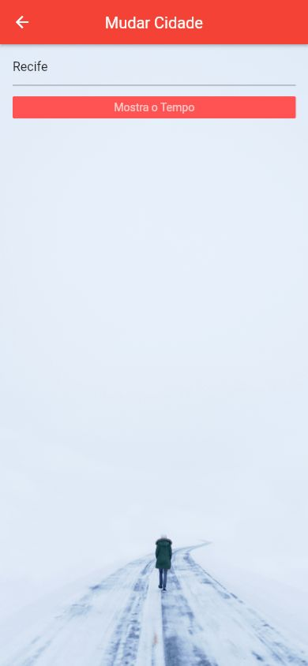
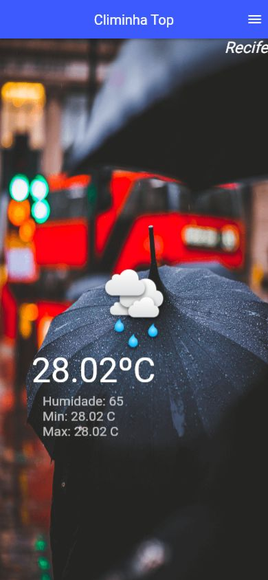

# Climinha Top Consulta de Clima

Aplicativo Flutter que consulta o clima de uma cidade pela API OpenWeatherMap. A tela mostra a temperatura atual e indicadores recebidos do serviço, e permite trocar a cidade por meio de uma tela de busca.

**Categoria:** Frontend · Aplicativo móvel · Consumo de API.

## Tecnologias principais

- Dart 2
- Flutter
- API OpenWeatherMap

## Funcionalidades

- Consultar uma cidade inicial configurada no aplicativo.
- Mostrar temperatura atual em graus Celsius.
- Exibir umidade e temperaturas mínima e máxima retornadas pela API.
- Abrir a busca, informar outra cidade e atualizar a tela principal.
- Utilizar imagens locais relacionadas ao clima na composição visual.

## Fluxo e organização

| Caminho | Responsabilidade |
| --- | --- |
| `lib/ui/climinha.dart` | Tela de clima e atualização dos indicadores. |
| `lib/telas/tela_cidade.dart` | Entrada do nome da cidade. |
| `lib/transacoes/pega_clima.dart` | Consulta HTTP ao serviço de clima. |
| `lib/util/util.dart` | Configuração da cidade inicial e do acesso à API. |
| `assets/` | Imagens utilizadas pela interface. |

A aplicação lê as condições retornadas para a cidade consultada. Não possui um backend próprio nem banco de dados local para histórico de consultas.

## Executar

Configure o acesso OpenWeatherMap e a cidade inicial em `lib/util/util.dart`, usando a sua própria chave no campo `appId`. O projeto foi escrito para Dart 2 e depende de `http 0.12.x`.

```bash
flutter pub get
flutter run --no-sound-null-safety
```

Use um dispositivo ou emulador compatível com o ambiente Flutter configurado. A versão original antecede null safety e requer atualização para Dart 3.

## Execução das capturas

A interface foi compilada com Flutter 2.10.5 e CanvasKit após gerar um destino web somente na cópia local. As consultas de Salvador e Recife receberam respostas reais da API. Na coleta de 13/10/2026, a interface exibiu 22,47 °C para Salvador e 28,02 °C para Recife. A imagem de chuva é um recurso fixo do aplicativo; não comprova a condição meteorológica retornada. As temperaturas nas imagens são valores daquele momento e não uma previsão permanente ou dados simulados.

## Relação com outros projetos

Aplicativo independente. A fonte de dados é OpenWeatherMap; não há relação de frontend/backend com os projetos Java da lista.

## Capturas do sistema

Capturas reais obtidas no navegador interno em 13/10/2026. Imagens móveis em **390 × 844 pixels**, mantendo a composição do aplicativo.

### Página inicial


### Busca por cidade



### Clima consultado para Recife



## Histórico

Repositório criado no GitHub em **2021-03-01**. Essa data identifica a criação do repositório; não comprova o início nem a conclusão do desenvolvimento.
